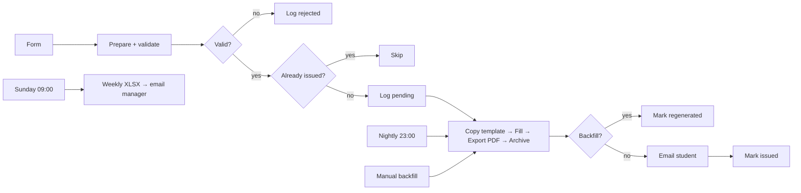

# Student Certificate Automation System

An [n8n](https://n8n.io) workflow that automates the full lifecycle of course-completion certificates for a training center: an instructor submits a form, and the system validates the request, prevents duplicates, generates a PDF from a Google Docs template, emails it to the student, and logs every step in Google Sheets.

It replaces manual certificate issuing (delays, name typos, duplicates, forgotten students) with four coordinated lanes.

## How it works

| Lane | Trigger | What it does |
|------|---------|--------------|
| **1. Event-driven** | Course Completion Form | Validates input, rejects scores below 60 or bad emails, skips duplicates, issues the certificate instantly |
| **2. Catch-up** | Schedule, nightly 23:00 | Re-processes `pending` / `failed` rows older than 15 minutes (max 20 per run) |
| **3. Backfill** | Manual trigger | Regenerates `issued` certificates whose `template_version` is not the current one (max 20 per run). No email is sent |
| **4. Weekly report** | Schedule, Sunday 09:00 | Emails the manager an Excel file of certificates issued in the last 7 days |

All lanes share one generation path: **Copy template → Fill placeholders → Export PDF → Archive in Drive → Email → Mark issued**.



**Idempotency:** `cert_id = slug(email) + "_" + slug(course)`. Email is trimmed and lower-cased first, so `  Ahmed.Hassan@Example.com ` and `ahmed.hassan@example.com` are the same student.

## Repository structure

```
├── workflows/
│   └── certificate_automation_hybrid.json   # n8n workflow (import this)
├── templates/
│   └── certificate_template.docx            # Certificate layout with {{placeholders}}
├── data/
│   ├── certificates_demo.xlsx               # Demo Google Sheet: Certificates + test tabs
│   ├── certificates_sample.csv              # Same data, "Certificates" tab only
│   └── form_test_inputs.csv                 # Inputs for testing the form (Lane 1)
├── docs/
│   └── TESTING.md                           # Test scenarios and expected results
├── LICENSE
└── README.md
```

## Prerequisites

- n8n (cloud or self-hosted) with a Google account connected
- Credentials for **Google Sheets**, **Google Docs**, **Google Drive**, and **Gmail** (OAuth2)
- Instance timezone set to `Africa/Cairo` or edit it in *Workflow Settings* (the cron times use the workflow timezone)

## Setup

### 1. Create the Google Sheet (uses `data/certificates_demo.xlsx`)

1. In Google Sheets: **File → Import → Upload** `data/certificates_demo.xlsx`.
2. Choose **Insert new sheet(s)** and **uncheck** *Convert text to numbers, dates, and formulas*. Dates must stay as ISO text (e.g. `2026-11-12T10:04:12.000+02:00`); otherwise Sheets converts them to local formats and the date logic breaks.
3. Keep the tab named **`Certificates`** and do not rename its columns. The workflow reads only this tab.
4. Copy the spreadsheet ID from the URL: `https://docs.google.com/spreadsheets/d/<SHEET_ID>/edit`.

For production, delete the demo rows and keep only the header row. The `Form_Test_Inputs`, `Test_Guide`, and `Read_Me` tabs can be deleted at any time.

### 2. Create the certificate template (uses `templates/certificate_template.docx`)

1. Upload `certificate_template.docx` to Google Drive, right-click → **Open with → Google Docs**, then **File → Save as Google Docs**.
2. Replace `YOUR TRAINING CENTER NAME` and adjust the design as needed. Keep the five placeholders exactly as written: `{{name}}` `{{course}}` `{{score}}` `{{date}}` `{{cert_id}}`.
3. Copy the document ID from the URL: `https://docs.google.com/document/d/<TEMPLATE_DOC_ID>/edit`.

### 3. Create the archive folder

Create a Drive folder (e.g. `Certificates`) and copy its ID from the URL: `https://drive.google.com/drive/folders/<FOLDER_ID>`.

### 4. Import the workflow

1. In n8n: **Workflows → Import from file** → `workflows/certificate_automation_hybrid.json`.
2. Open every Google/Gmail node and select your credentials.
3. Replace the placeholders:

| Placeholder | Where | Replace with |
|-------------|-------|--------------|
| `REPLACE_WITH_GOOGLE_SHEET_ID` | 8 Sheets nodes (Log Rejected, Check Duplicate, Log Pending, Read Sheet – Nightly / Backfill / Weekly, Mark Issued, Mark Regenerated) | `<SHEET_ID>` |
| `REPLACE_WITH_TEMPLATE_DOC_ID` | Copy Template | `<TEMPLATE_DOC_ID>` |
| `REPLACE_WITH_CERTIFICATES_FOLDER_ID` | Archive PDF in Drive | `<FOLDER_ID>` |
| `manager@example.com` | Email Manager | Manager's real email |

4. Optional: attach an error workflow under **Settings → Error Workflow** so failures notify you.

### 5. Activate

1. Toggle the workflow **Active**. The two schedule triggers start running.
2. Open the **Course Completion Form** node and copy the **Production URL**. Share it with instructors.

## Usage

| Task | How |
|------|-----|
| Issue a certificate | Instructor opens the form URL and submits Full Name, Email, Course, Score (≥ 60) |
| Check status | Open the `Certificates` tab: `issued`, `pending`, `failed`, or `rejected` (reason in `error`) |
| Retry a stuck certificate | Wait for the nightly run, or re-submit the same form data (a `pending` row completes; an `issued` row is skipped) |
| Apply a new template to old certificates | See [Updating the template](#updating-the-template) |
| Weekly report | Arrives every Sunday 09:00; run the **Schedule Sunday 09:00** trigger manually to get one now |

### Status values

| Status | Meaning |
|--------|---------|
| `pending` | Request logged, certificate not yet sent (picked up by Lane 2 after 15 min) |
| `issued` | PDF generated, archived, and emailed |
| `failed` | An earlier attempt errored (e.g. Gmail timeout); retried by Lane 2 |
| `rejected` | Invalid request (missing name, bad email, score < 60). Never retried |

## Configuration

| Setting | Location | Default |
|---------|----------|---------|
| Passing mark | `Prepare Request` code node (`score < 60`) | 60 |
| Course list | `Course Completion Form` dropdown | AI Automation, Data Analysis, Digital Marketing |
| Catch-up age / batch size | `Find Pending` code node | 15 min / 20 |
| Schedules | `Schedule Nightly 23:00`, `Schedule Sunday 09:00` | `0 23 * * *`, `0 9 * * 0` |
| Email wording | `Email Certificate`, `Email Manager` | English |

### Updating the template

When you redesign the certificate, change the version in **two** places so they stay in sync:

1. `Set Cert Data` node → `template_version` value (e.g. `v3`)
2. `Select Old Certificates` code node → `const TEMPLATE_VERSION = 'v3'`

Then run **Manual Backfill Trigger**. It regenerates only `issued` rows with an older version, saves the new PDFs to Drive without emailing, and records `regenerated_at`. Run it again until it finds nothing (20 per run). Use the `COURSE` constant to limit a run to one course.

## Testing

Use `data/form_test_inputs.csv` for the form and the `Test_Guide` tab in `certificates_demo.xlsx` for the lane tests. Replace `@example.com` with your own address wherever you want to receive the email. Full scenarios and expected results are in [docs/TESTING.md](docs/TESTING.md).

## Known limitations

- **Working copies remain in Drive.** `Copy Template` creates a Google Doc per certificate; only the PDF is archived to the folder. Clean the template's folder periodically or add a Drive delete step.
- **Backfill creates a second PDF** with the same file name in the archive folder; Drive allows duplicate names.
- **Dates must be ISO text** in `created_at` / `issued_at`. A locale-formatted value such as `14/11/2026` is unparseable, so that row is ignored by the weekly report and the catch-up age check.
- **Gmail sending limits** apply (about 500/day for personal accounts). The 20-item batches keep nightly runs well below this.
- **Sheets concurrency:** two simultaneous submissions for the same student could both pass the duplicate check. Unlikely for form-based use.

## License

[MIT](LICENSE). All sample data is fictional.
